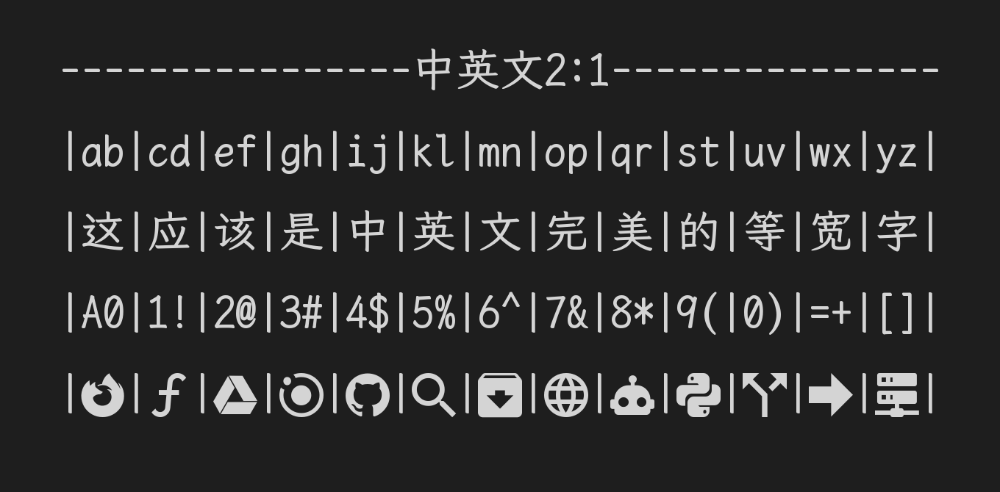

# JKaiMono

English | [中文](README.md)

2:1 CJK monospace coding font merging LXGW WenKai Mono Screen and Nerd Font symbols.



## Features

- **Latin Font**: Inconsolata (1024 advance width)
- **CJK Font**: LXGW WenKai Mono Screen (v1.522, 46,523 characters, 2048 advance width)
- **Icon Extension**: Symbols Nerd Font Mono (v3.5.1, 10,594 developer icons at 2048 width)
- **Strict Monospace**: 1:2 ratio (Latin 1024 / CJK & icons 2048), optimized for terminals and code alignment
- **Non-destructive Merging**: Preserves existing glyphs from base font; only adds missing Nerd Font icons

## Quick Build

### Install Dependencies

```bash
pip install fonttools pyyaml
```

### Build Font

```bash
python build.py
```

Generated font is saved to `output/fonts/JKaiMono.ttf`.

## Installation & Setup

### 1. Install Font (macOS)

```bash
cp output/fonts/JKaiMono.ttf ~/Library/Fonts/
```

### 2. Editor & Terminal Settings (VS Code / Kaku / Ghostty / WezTerm / iTerm2)

- **VS Code / VSCodium / Cursor**:
  ```json
  {
    "editor.fontFamily": "'JKaiMono', monospace",
    "editor.fontSize": 14,
    "editor.lineHeight": 1.55,
    "terminal.integrated.fontFamily": "'JKaiMono', monospace"
  }
  ```
- **Terminals (Kaku / Ghostty / WezTerm / iTerm2)**:
  Set font family to `JKaiMono`.

## Configuration

Modify `config.yaml` to adjust build parameters:

```yaml
font:
  family_name: "JKaiMono"
  version: "2.0"

fonts_dir: "fonts"
nerd_font: "SymbolsNerdFontMono-Regular.ttf"

styles:
  Regular:
    base_font: "LXGWWenKaiMonoScreen.ttf"
    display_name: "Regular"
    output_filename: "JKaiMono.ttf"

build:
  styles: "Regular"
  output_dir: "output/fonts"
  parallel: 1

width:
  monospace: true
  en_width: 1024
  cn_width: 2048
  visual_scale: 1.0
```

## Source Fonts

Located in `fonts/`:
- `LXGWWenKaiMonoScreen.ttf` (LXGW WenKai Mono Screen v1.522)
- `SymbolsNerdFontMono-Regular.ttf` (Nerd Fonts v3.5.1 Symbols Only Mono)

## License

- LXGW WenKai: SIL Open Font License 1.1
- Nerd Fonts: MIT License
